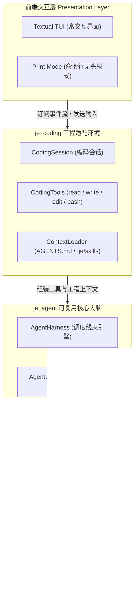

# Je ⚡

> **运行在终端中的新一代自主 AI 编码智能体 (Autonomous Terminal Coding Agent)**

[](LICENSE)
[](https://www.python.org/downloads/)
[](https://docs.astral.sh/uv/)

Je 是一个面向专业开发者、轻量且高度可扩展的终端 AI 编程助手。只需输入自然语言需求（例如 *“解释这个模块的实现”*、*“为这个函数补充单元测试”* 或 *“重构这个模块的异步边界”*），Je 便能自主检索工程文件、规划变更方案、精准编辑源码、执行终端命令并持续流式展示执行过程，同时将完整的会话历史安全持久化在本地。

---

## 🏗 核心架构设计 (Architecture)

Je 秉承**极简、高内聚、低耦合**的工程哲学，严格遵循三层分层解耦架构：



| 分层命名 | 核心定位 | 主要职责与边界 |
| :--- | :--- | :--- |
| **`je_ai`** | 统一大模型通信层 | 封装异构大模型协议（OpenAI、Anthropic、Ollama、DeepSeek、Hugging Face 等），将其转换为与厂商中立的标准异步事件流（Event Stream）。不含任何 Agent 业务逻辑。 |
| **`je_agent`** | 通用 Agent 调度引擎 | 整个智能体的核心大脑：包含自主推理执行循环（ReAct Loop）、工具调用编排、状态机流转、不可变消息模型及树状持久化存储。**完全独立于 UI 和文件系统**，可作为纯 Python 库嵌入任意后端或应用。 |
| **`je_coding`** | 终端编码助理环境 | 完整的终端落地应用：集成面向本地工程的实用工具集、工作区规则感知（`.je/`、`AGENTS.md`、Skills 技能包）、Textual 现代化交互 TUI 及命令行无头输出模式。 |

---

## 💡 核心架构亮点 (Core Engineering Highlights)

围绕现代 AI Agent 工业级落地的核心诉求（高内聚执行流、可观测性、安全性拦截与低延迟流式吞吐），Je 在 **Agent Runtime（运行时）** 层面进行了深度架构设计：

### 1. 全异步细粒度事件流运行时 (Async Event-Driven Runtime)
`je_agent` 核心引擎采用**完全异步生成器 (`AsyncIterator[AgentEvent]`)** 贯穿整个 ReAct 主执行循环：
- **微观全生命周期感知**：标准化定义了从 `AgentStart`、`TurnStart`、`MessageUpdate` 到 `ToolExecutionStart/Update/End` 的强类型事件流，打字机文本、CoT 思考过程（Thinking Delta）与工具执行进度均实现**零缓冲实时流式推送**。
- **纯粹的前后端契约解耦**：Agent 核心大脑不包含任何终端绘制或特定前端绑定代码（无 UI 污染）。上层无论是消费为 Rich 命令行输出、Textual 响应式 TUI，还是通过 WebSocket/SSE 接入 Web 端，只需监听事件流即可直接驱动，具备工业级 SDK 嵌入能力。

### 2. 双向生命周期 Hook 与动态方向控制 (Lifecycle Hooks & Dynamic Steering)
在 Agent 自主推理执行主循环（`run_agent_loop`）中内置了严格的企业级安全与动态干预机制：
- **工具调用前置拦截 (`before_tool_call`)**：支持执行前风控校验、权限鉴权（如写盘/Shell 敏感命令审批）或参数动态篡改重写；若判定高危可直接熔断中断（Block），从底层确保 Agent 代码执行的确定性与安全性。
- **工具调用后置修饰 (`after_tool_call`)**：执行完成后可无缝注入结果清洗、脱敏过滤或自动异常捕获补偿。
- **动态消息导向与自主跟随 (`get_steering_messages` & `get_follow_up_messages`)**：支持外部在执行轮次间隙动态注入插队指导消息（Steering），无需中断 Agent 状态机即可实现用户动态干预与任务纠偏。

### 3. 基于不可变树的只追加会话存储 (Append-Only Tree-Structured History)
彻底告别传统 Agent 常见的“粗暴覆写式”扁平聊天记录：
- **零丢失与不可变状态机**：交互历史以 JSONL 只追加（Append-Only）方式落盘，每个节点记录完整的推理、工具调用及时间戳元数据，杜绝并发竞态下的数据损坏。
- **会话分叉与时空回溯 (Branching & Resuming)**：支持从任意历史节点无损衍生出新分支，轻松实现会话快速恢复（`/resume`）、多方案分叉实验与上下文精简压缩。

### 4. 生产级韧性与弹性降级 (Production Resilience & Context Repair)
- **上下文自动修复 (`repair_tool_history`)**：在网络抖动或模型突发异常导致工具执行中断时，运行时自动校验并修复消息上下文链条（补齐对应 ToolResult 占位），防止脏上下文引发大模型二次崩溃。
- **超时熔断与取消级联 (`CancellationToken`)**：支持用户端一键秒级取消正在执行的推理或长耗时工具，级联终止底层 HTTP 异步连接与系统子进程。

### 5. 即插即用的全生态模型适配 (Plug-and-Play Model Matrix)
屏蔽各厂商 API 的细微差异，支持无缝切换与平滑演进：
- **全面适配主流与新一代大模型**：深层调优并支持 DeepSeek 系列（V3/R1 及 `deepseek-v4-flash/pro`）、OpenAI 系列（GPT-4o、新一代 `gpt-5/6`、Codex 专版）、Claude（Sonnet 4/Opus 5 系列）、Kimi（K2.7/K3）、GLM 等。
- **一键切换服务商**：无缝对接官方接口、聚合网关（Together、Fireworks、OpenCode）以及企业内网私有部署的 Ollama / vLLM 推理服务，只需一行配置，无需重写任何业务代码。

---

## 🚀 快速上手 (Quickstart)

### 前置环境

- **Python 3.12+**
- 推荐使用现代 Python 包管理器 [**`uv`**](https://docs.astral.sh/uv/)

### 源码安装与运行

```bash
# 1. 克隆仓库
git clone git@github.com:JeffreyLei03/JE.git
cd JE

# 2. 安装项目依赖与开发环境
uv sync --dev

# 3. 验证安装
uv run je --version
# 输出: je 0.1.0
```

### 两种运行模式

#### 1. 交互式终端模式 (TUI)
启动全功能、支持主题和键盘快捷键的 Textual 终端界面：
```bash
uv run je
```

#### 2. 命令行单次执行模式 (Print Mode)
无需进入交互界面，适用于脚本化调用或快速提问：
```bash
uv run je -p "总结当前代码库的核心架构"
uv run je --cwd /path/to/project -p "定位 CLI 入口文件"
```

#### 3. 安装为全局命令
将当前开发版本安装为系统的全局命令工具：
```bash
uv tool install --editable .
je --help
```

---

## 🛠 核心功能特性 (Features)

- **现代终端交互界面 (TUI)**：基于 Textual 构建，支持快捷键导航、多主题切换（`je-dark` / `je-light` / 高对比度）、流式打字机效果及实时进度看板。
- **全功能内置工具集**：
  - `read`：高效读取文本与多模态图片文件（JPEG、PNG、GIF、WebP），超大文件自动智能截断与续读提示。
  - `write`：原子化全量写入或新建文件，自动处理缺失父目录。
  - `edit`：高精度局部块替换，具备严格的唯一性校验与原子回滚机制。
  - `bash`：在当前工作区安全执行终端命令，实时捕获输出并支持超时熔断。
- **只追加树状会话持久化**：所有交互记录保存在 `~/.je/sessions/`，以 JSONL 树状结构存储，支持会话无损恢复（`/resume`）与历史分支分叉。
- **工程上下文规则注入**：自动识别工作区中的 `AGENTS.md`、`.je/skills/` 技能及 `.je/SYSTEM.md` 系统提示词。
- **多模型与本地生态支持**：无缝对接 OpenAI、Anthropic、Ollama 本地大模型、DeepSeek 以及任何兼容 OpenAI 规范的 API 接口。

---

## 📦 作为独立 Python 库调用 (Library Usage)

得益于 `je_agent` 核心引擎的无 UI 依赖设计，你可以在自己的脚本或独立应用中直接嵌入 Je 的智能体大脑：

```python
import asyncio
from je_ai.openai_compatible import OpenAICompatibleProvider, OpenAICompatibleConfig
from je_agent import AgentHarness, AgentHarnessConfig
from je_coding.tools import create_coding_tools

async def main():
    # 配置模型提供商
    provider = OpenAICompatibleProvider(
        OpenAICompatibleConfig(
            api_key="your-api-key",
            base_url="https://api.deepseek.com/v1",
        )
    )
    
    # 构建智能体大脑
    harness = AgentHarness(
        AgentHarnessConfig(
            provider=provider,
            model="deepseek-chat",
            system="你是一名资深的自主软件架构师。",
            tools=create_coding_tools(cwd="."),
        )
    )

    # 订阅事件流并输出
    async for event in harness.prompt("分析当前目录下的核心文件"):
        if event.type == "message_delta":
            print(event.delta, end="", flush=True)

asyncio.run(main())
```

---

## 🧪 自动化测试与质量保障 (Verification)

本项目包含完善的自动化测试套件与代码规范检查：

```bash
# 运行单元测试
uv run pytest

# 静态代码规范检查
uv run ruff check .

# 检查代码格式
uv run ruff format --check .

# 严格类型检查
uv run mypy
```

---

## 🛡 开发流程规范 (Development Workflow)

本项目遵循严格的工业级工程规范：

- **主分支保护 (Branch Protection)**：`main` 分支作为唯一的生产发布分支，受到受控保护，禁止强制推送与直接变更。
- **分支开发模式**：所有新特性与缺陷修复均基于功能分支开发（`feat/*`、`fix/*`）。
- **持续集成门禁 (CI Pipeline)**：通过 GitHub Actions 自动化门禁检测，所有 PR 必须在通过 `pytest`、`ruff` 和 `mypy` 校验后方可合并。

---

## 📄 开源许可证与致谢 (License & Acknowledgments)

本项目基于 [MIT 许可证](LICENSE) 开源。

**致谢声明 (Acknowledgments)**：
Je 的架构设计灵感来源于 Pi 与 Tau 极简智能体线束架构，并在其思想之上进行了深度本土化重构与工程演进。
