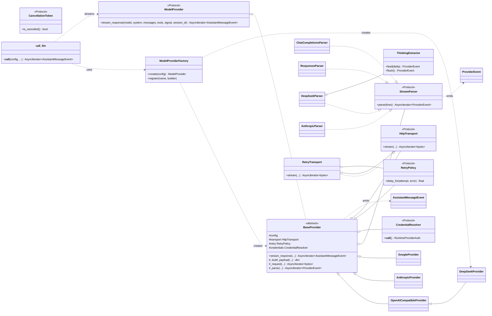

这是一个典型的“上帝函数”问题。我先给出诊断，再给出方案、类图与代码。需要说明的是：**这正是 Je 现有架构已经采用的方向**——`je_agent/provider.py` 定义了供应商中立的 `ModelProvider` 协议，`je_ai/` 下每个厂商一个适配器，`je_coding/provider_runtime.py` 做工厂组装，重试/流解析/鉴权各自独立。下面的方案与这套真实分层保持一致。

---

## 1. 重构方案与设计模式

### 1.1 拆解单体函数的五类耦合

| 关注点 | 现状 | 重构归属 |
|---|---|---|
| 鉴权读取 | `if provider == ...` 里读 env/OAuth | `CredentialResolver`（Command/可调用对象） |
| 请求体构造 | 每个分支手搓 dict | 各 Adapter 的 `_build_payload()` |
| 流式解析 | 分支内 `for line in resp` | `StreamParser` 策略 + 统一 Pipeline |
| 思考提取 | `<think>` 正则 / `reasoning_content` | Parser 内部归一化为 `ThinkingDeltaEvent` |
| 失败重试 | try/except 包住整段 | `RetryTransport`（Decorator） |

### 1.2 采用的设计模式

1. **Protocol + 依赖倒置（DIP）**：核心引擎只依赖 `ModelProvider` 协议，不 import 任何厂商 SDK；`je_agent` 定义契约，`je_ai` 实现。
2. **Adapter（适配器）**：`DeepSeekProvider`、`AnthropicProvider`、`OpenAICompatibleProvider` 把各家协议适配成统一的类型化事件流。
3. **Strategy（策略）**：`StreamParser` 抽象“如何把字节流解析成 `ProviderEvent`”，Chat Completions 与 Responses 是两种可替换策略。
4. **Factory + Registry（工厂/注册表）**：`create_model_provider(config)` 按配置类型分发，扩展可注册新 provider，杜绝字符串 `if/elif`。
5. **Pipeline（管道）**：`raw SSE → ProviderEvent → AssistantMessageEvent` 两段式，`stream.py::canonicalize_provider_stream` 负责第二步，厂商解析器只管第一步。
6. **Decorator（装饰器）**：重试、鉴权注入像洋葱一样包在传输层外。
7. **Command（命令对象）**：`CredentialResolver` 是一个 `async () -> RuntimeProviderAuth` 可调用对象，在请求前一刻解析（支持 OAuth 刷新）。
8. **Observer（观察者）**：`stream_response` 返回 `AsyncIterator[AssistantMessageEvent]`，UI 只消费事件、不感知厂商。

### 1.3 重构收益

- **开闭原则**：新增厂商 = 新增一个 Adapter + 注册一行，不改核心循环。
- **单一职责**：鉴权、构造、解析、重试各自可独立测试（Fake Provider / Fake Transport）。
- **可测性**：注入 `httpx.AsyncClient` 或 Fake transport，无需真实网络。
- **表现层解耦**：`je_agent` 不依赖 Textual/Rich，事件驱动。

---

## 2. 重构后类与协议关系图



---

## 3. 代码

### 3.1 抽象协议（`je_agent/provider.py`，与仓库一致）

```python
"""Je 核心智能体层拥有的模型提供商接口契约。"""
from __future__ import annotations

from collections.abc import AsyncIterator
from typing import Protocol

from je_agent.messages import AgentMessage
from je_agent.provider_events import AssistantMessageEvent
from je_agent.tools import AgentTool


class CancellationToken(Protocol):
    def is_cancelled(self) -> bool:
        """当前流是否应停止。"""
        ...


class ModelProvider(Protocol):
    """供应商中立的模型流式接口。核心循环只依赖于此。"""

    def stream_response(
        self,
        *,
        model: str,
        system: str,
        messages: list[AgentMessage],
        tools: list[AgentTool],
        signal: CancellationToken | None = None,
        session_id: str | None = None,
    ) -> AsyncIterator[AssistantMessageEvent]:
        """把一个模型响应作为助手消息事件流返回。"""
        ...
```

### 3.2 共享基类：模板方法 + 可插拔策略（`je_ai/base.py`）

```python
"""供应商适配器共享的流式骨架：构造 → 传输(重试) → 解析 → 归一化。"""
from __future__ import annotations

from abc import ABC, abstractmethod
from collections.abc import AsyncIterator, Mapping
from typing import Any, Protocol

from je_agent.provider import ModelProvider
from je_ai._provider_events import ProviderEvent
from je_ai.stream import canonicalize_provider_stream


class CredentialResolver(Protocol):
    async def __call__(self) -> Mapping[str, str]:
        """请求前一刻解析出的请求头/密钥。"""...


class StreamParser(Protocol):
    """把厂商原始 SSE 行翻译成供应商中立的 ProviderEvent。"""

    def parse(self, lines: AsyncIterator[bytes]) -> AsyncIterator[ProviderEvent]: ...


class HttpTransport(Protocol):
    def stream(
        self, *, url: str, headers: Mapping[str, str], payload: dict[str, Any]
    ) -> AsyncIterator[bytes]: ...


class BaseProvider(ModelProvider, ABC):
    """消除各厂商重复的 stream 骨架。子类只填 payload 与 parser。"""

    def __init__(
        self,
        *,
        api: str,
        provider: str,
        base_url: str,
        transport: HttpTransport,
        credentials: CredentialResolver,
        parser: StreamParser,
    ) -> None:
        self._api = api
        self._provider = provider
        self._base_url = base_url.rstrip("/")
        self._transport = transport
        self._credentials = credentials
        self._parser = parser

    def stream_response(self, *, model, system, messages, tools, signal=None, session_id=None):
        raw_provider_events = self._stream_provider_events(
            model=model, system=system, messages=messages, tools=tools, signal=signal
        )
        # Pipeline 第二段：ProviderEvent → 统一的 AssistantMessageEvent
        return canonicalize_provider_stream(
            raw_provider_events, api=self._api, provider=self._provider, model=model
        )

    async def _stream_provider_events(self, *, model, system, messages, tools, signal):
        headers = {**(await self._credentials()), **self._extra_headers()}
        payload = self._build_payload(
            model=model, system=system, messages=messages, tools=tools
        )
        url = f"{self._base_url}{self._endpoint()}"
        async for event in self._parser.parse(
            self._transport.stream(url=url, headers=headers, payload=payload)
        ):
            if signal is not None and signal.is_cancelled():
                return
            yield event

    def _extra_headers(self) -> Mapping[str, str]:
        return {}

    @abstractmethod
    def _endpoint(self) -> str: ...

    @abstractmethod
    def _build_payload(self, *, model, system, messages, tools) -> dict[str, Any]: ...
```

### 3.3 DeepSeek 适配器（`je_ai/deepseek.py`）

DeepSeek 走 OpenAI 协议，但推理内容在 `delta.reasoning_content` 而非 `<think>` 标签——用 `ThinkingExtractor` 归一化。为紧凑起见，这里给出解析器与适配器关键部分。

```python
"""DeepSeek 适配器：OpenAI 兼容协议 + reasoning_content 思考通道。"""
from __future__ import annotations

from collections.abc import AsyncIterator, Mapping
from dataclasses import dataclass
from typing import Any

from je_agent.messages import AgentMessage, AssistantMessage, ThinkingContent
from je_agent.tools import AgentTool
from je_ai._provider_events import (
    ProviderEvent,
    ProviderResponseEndEvent,
    ProviderResponseStartEvent,
    ProviderTextDeltaEvent,
    ProviderThinkingDeltaEvent,
)
from je_ai.base import BaseProvider, StreamParser


class DeepSeekParser(StreamParser):
    """把 DeepSeek 的 SSE 翻译成 ProviderEvent。

    - `delta.content`           → ProviderTextDeltaEvent
    - `delta.reasoning_content` → ProviderThinkingDeltaEvent
    两者是独立通道，可交错到达，因此不需要“关闭上一个块”。
    """

    def __init__(self, *, model: str) -> None:
        self._model = model

    async def parse(self, lines: AsyncIterator[bytes]) -> AsyncIterator[ProviderEvent]:
        yield ProviderResponseStartEvent(response_provider="deepseek")
        async for line in lines:
            line = line.strip()
            if not line.startswith(b"data:"):
                continue
            data = line[len(b"data:") :].strip()
            if data == b"[DONE]":
                break
            chunk = _loads(data)
            for choice in chunk.get("choices", []):
                delta = choice.get("delta") or {}
                if text := delta.get("content"):
                    yield ProviderTextDeltaEvent(delta=text)
                if reasoning := delta.get("reasoning_content"):
                    yield ProviderThinkingDeltaEvent(delta=reasoning)
        yield ProviderResponseEndEvent(message=AssistantMessage(…), finish_reason="stop")


class DeepSeekProvider(BaseProvider):
    """DeepSeek 官方 API 适配器。"""

    def __init__(self, *, api_key: str, base_url: str = "https://api.deepseek.com",
                 model: str = "deepseek-chat", transport, credentials=None) -> None:
        super().__init__(
            api="deepseek-chat",
            provider="deepseek",
            base_url=base_url,
            transport=transport,
            credentials=credentials or _static_bearer(api_key),
            parser=DeepSeekParser(model=model),
        )
        self._model = model

    def _endpoint(self) -> str:
        return "/chat/completions"

    def _build_payload(self, *, model, system, messages: list[AgentMessage],
                       tools: list[AgentTool]) -> dict[str, Any]:
        payload: dict[str, Any] = {
            "model": model or self._model,
            "messages": [{"role": "system", "content": system}]
            + [_message_to_wire(m) for m in messages],
            "stream": True,
        }
        if tools:
            payload["tools"] = [_tool_to_wire(t) for t in tools]
            payload["tool_choice"] = "auto"
        return payload

    def _extra_headers(self) -> Mapping[str, str]:
        return {"Content-Type": "application/json"}


def _static_bearer(api_key: str):
    async def resolve() -> Mapping[str, str]:
        return {"Authorization": f"Bearer {api_key}"}
    return resolve
```

> 关键点：`reasoning_content` → `ProviderThinkingDeltaEvent` 的映射发生在**厂商解析器**内；`canonicalize_provider_stream` 再把它变成 UI 可消费的 `ThinkingStart/Delta/End`。思考标签的差异被彻底关进适配器。

### 3.4 工厂 + 统一调用入口（`je_coding/provider_runtime.py` 的简化版）

```python
"""运行时模型提供商工厂与统一调用入口，杜绝字符串 if/elif。"""
from __future__ import annotations

from collections.abc import Callable
from typing import Any

from je_agent.provider import ModelProvider

# 注册表：新增厂商只需在此注册一个 builder，开放封闭。
_BUILDERS: dict[str, Callable[[Any], ModelProvider]] = {}


def register_provider(kind: str, builder: Callable[[Any], ModelProvider]) -> None:
    _BUILDERS[kind] = builder


def create_model_provider(config: Any) -> ModelProvider:
    """按配置类型分发到对应适配器。"""
    builder = _BUILDERS.get(config.kind)
    if builder is None:
        raise ValueError(f"Unsupported provider: {config.kind!r}")
    return builder(config)


# ---- 注册内置厂商（放在模块底部，扩展可追加）----
register_provider("deepseek", lambda c: DeepSeekProvider(
    api_key=c.api_key, base_url=c.base_url, model=c.model,
    transport=RetryTransport(HttpTransport(), policy=c.retry),
))
register_provider("anthropic", lambda c: AnthropicProvider(...))
register_provider("openai-compatible", lambda c: OpenAICompatibleProvider(...))


async def call_llm(
    config: Any,
    *,
    system: str,
    messages: list[Any],
    tools: list[Any] = (),
    signal: Any = None,
) -> "AsyncIterator[Any]":
    """统一调用入口：构造 provider 并把事件流原样转发给调用方。"""
    provider = create_model_provider(config)
    try:
        async for event in provider.stream_response(
            model=config.model, system=system,
            messages=list(messages), tools=list(tools), signal=signal,
        ):
            yield event
    finally:
        aclose = getattr(provider, "aclose", None)
        if aclose is not None:
            await aclose()
```

调用方变成：

```python
async for event in call_llm(cfg, system=sys, messages=msgs, tools=tools):
    match event.type:            # start / text_delta / thinking_delta / toolcall_end / done
        case "thinking_delta":   render_thinking(event.delta)
        case "text_delta":       render_text(event.delta)
        case "done":             finalize(event.message)
```

---

### 小结

- **协议**（`ModelProvider` / `StreamParser` / `HttpTransport` / `CredentialResolver`）把 5 类关注点各自隔离。
- **策略 + 适配器**吸收厂商差异（DeepSeek 的 `reasoning_content` 与 Claude 的 thinking block 都被归一化）。
- **管道**把“厂商字节 → ProviderEvent → 统一事件”拆成可独立测试的两段。
- **工厂 + 注册表**替代 20 多个 `if/elif`，新增厂商零改动核心。
- **装饰器**让重试、鉴权刷新透明叠加。

这套结构正是当前 `je_agent`（契约）、`je_ai`（适配器）、`je_coding/provider_runtime.py`（工厂组装）三层的职责划分，可直接对照仓库中的 `ModelProvider`、`canonicalize_provider_stream` 与 `create_model_provider` 阅读落地实现。
