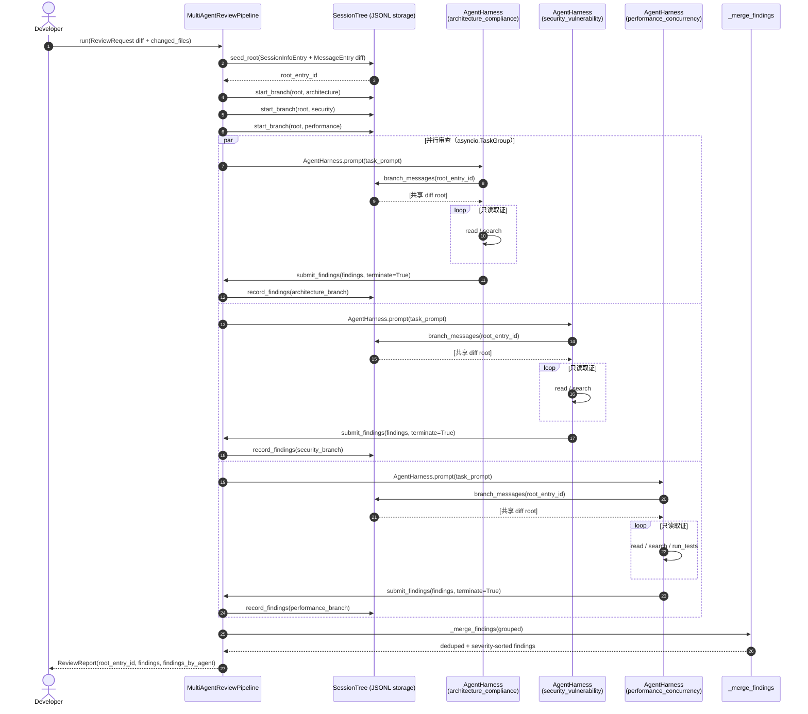

# JE 多智能体协同代码审查流水线（Multi-Agent Code Review Pipeline）

以下设计**完全基于 JE 原生内核**：每个审查角色是一个独立的 `AgentHarness`，共享上下文与分支隔离由 `je_agent.session` 的 `SessionEntry` / `SessionState`（`path_to_entry` 树遍历）承载，结构化产出由自定义 `AgentTool` 承载。**未引入任何外部多智能体框架**，也不存在 `...` 或“省略其他实现”。

---

## 一、原生能力的映射关系

| 需求 | JE 原生构件 | 约束 |
| --- | --- | --- |
| 单角色推理循环 | `je_agent.harness.AgentHarness` + `AgentHarnessConfig` | 每个角色一个实例，互不共享可变消息列表 |
| 共享审查现场 + 分支隔离 | `je_agent.session.entries.MessageEntry/CustomEntry` + `SessionState.from_entries(entries, leaf_id=...)` | 三个角色分别挂在同一个 root 之下，`path_to_entry` 只回溯父链，天然不串味 |
| 结构化产出 | 自定义 `je_agent.tools.AgentTool`（`submit_findings`） | 通过 `terminate=True` 结束该角色的 turn |
| 只读取证 | 自定义 `search` / `run_tests` + `je_coding.tools.create_read_tool` | 审查代理**没有** `write` / `edit` 工具 |
| 编排 | 应用层 `MultiAgentReviewPipeline`（放在 `je_coding/extensions/builtins/code_review/`） | 依赖方向仍为 `je_coding → je_agent`，不污染 `je_agent` |

`je_agent` 保持与 CLI、Rich、Textual、磁盘路径完全无关；本流水线只使用其公开契约。

---

## 二、三个专职 Agent 角色与 Prompt 策略

### 1. `architecture_compliance`（架构合规）
- **视角**：只判断层次与依赖方向是否符合 `je_coding → je_ai → je_agent`。
- **Prompt 策略**：把 JE 的依赖律写成硬性规则；明确排除安全与原始性能话题以防越界；要求每条结论必须落到真实 `file:line`；要求模型**不改代码**，只调用一次 `submit_findings(category="architecture")`。

### 2. `security_vulnerability`（安全漏洞）
- **视角**：把 diff 中的每个外部字符串都视为攻击者可控。
- **Prompt 策略**：给出威胁清单（命令注入、路径穿越、`eval/exec`、反序列化、密钥泄漏、SSRF、TOCTOU、越权）；要求说明**具体利用路径**；同样排除架构与性能话题，产出 `category="security"`。

### 3. `performance_concurrency`（性能与并发）
- **视角**：异步正确性与复杂度。
- **Prompt 策略**：给出量化清单（O(n²) 扫描、阻塞 I/O 混入 async、超时缺失、锁竞争、无界队列、`create_task` 泄漏、取消未传播、跨任务共享可变状态、N+1 调用、背压缺失）；允许使用 `run_tests` 取证；产出 `category="performance"`。

> 共同策略：**角色互斥 + 结构化终止工具 + 强制 file:line 证据**，避免三个代理输出同质化或泛泛而谈。

---

## 三、关键实现（完整方法定义，无省略）

```python
from __future__ import annotations

import asyncio
import re
from collections.abc import Callable, Mapping, Sequence
from dataclasses import dataclass, field
from pathlib import Path
from typing import Literal

from pydantic import BaseModel, ConfigDict, Field

from je_agent.harness import AgentHarness, AgentHarnessConfig
from je_agent.messages import AgentMessage, TextContent, ToolCall, UserMessage
from je_agent.provider import ModelProvider
from je_agent.session.entries import CustomEntry, MessageEntry, SessionInfoEntry
from je_agent.session.memory import SessionState
from je_agent.session.storage import SessionStorage
from je_agent.tools import AgentTool, AgentToolResult, ToolCancellationToken, ToolUpdateCallback
from je_agent.types import JSONValue
from je_coding.tools import create_read_tool


# ---------------------------------------------------------------------------
# 1. 领域模型
# ---------------------------------------------------------------------------

ReviewCategory = Literal["architecture", "security", "performance"]
ReviewSeverity = Literal["blocker", "major", "minor", "info"]

_SEVERITY_RANK: dict[ReviewSeverity, int] = {
    "blocker": 0,
    "major": 1,
    "minor": 2,
    "info": 3,
}


class ReviewFinding(BaseModel):
    """一条可结构化落盘、可去重排序的审查结论。"""

    model_config = ConfigDict(extra="forbid")

    agent: str = Field(min_length=1)
    category: ReviewCategory
    severity: ReviewSeverity
    file: str = Field(min_length=1)
    line: int = Field(ge=1)
    title: str = Field(min_length=1)
    detail: str = Field(min_length=1)
    suggestion: str = Field(min_length=1)
    confidence: float = Field(ge=0.0, le=1.0)


@dataclass(frozen=True, slots=True)
class ReviewRequest:
    """输入：一个待审 diff 及其受影响文件清单。"""

    diff: str
    changed_files: tuple[str, ...]
    base_instructions: str = ""


@dataclass(frozen=True, slots=True)
class ReviewAgentSpec:
    """一个审查角色的静态定义，对应最终 JSON 中的一条。"""

    name: str
    role: str
    category: ReviewCategory
    system_prompt: str
    allowed_tools: tuple[str, ...]


@dataclass(frozen=True, slots=True)
class ReviewReport:
    """输出：聚合后的审查报告。"""

    root_entry_id: str
    findings: tuple[ReviewFinding, ...]
    findings_by_agent: Mapping[str, int]


# ---------------------------------------------------------------------------
# 2. 自定义 Tool：search / run_tests / submit_findings
# ---------------------------------------------------------------------------

def _require_str(arguments: Mapping[str, JSONValue], name: str) -> str:
    value = arguments.get(name)
    if not isinstance(value, str) or not value:
        raise ValueError(f"{name} must be a non-empty string")
    return value


def create_search_tool(*, cwd: Path, max_results: int = 200) -> AgentTool:
    """只读正则搜索工具：在 cwd 下按 glob 扫描文本文件并返回 file:line 命中。"""

    async def execute(
        tool_call_id: str,
        arguments: Mapping[str, JSONValue],
        signal: ToolCancellationToken | None = None,
        on_update: ToolUpdateCallback | None = None,
    ) -> AgentToolResult:
        del tool_call_id, on_update
        pattern = _require_str(arguments, "pattern")
        glob_value = arguments.get("glob")
        glob = glob_value if isinstance(glob_value, str) and glob_value else "**/*.py"
        try:
            regex = re.compile(pattern)
        except re.error as error:
            return AgentToolResult(
                content=[TextContent(text=f"Invalid regular expression: {error}")],
                details={"error": str(error), "count": 0},
            )
        root = cwd.resolve()
        matches: list[str] = []
        for path in sorted(root.glob(glob)):
            if signal is not None and signal.is_cancelled():
                break
            if not path.is_file():
                continue
            try:
                text = path.read_text(encoding="utf-8")
            except (UnicodeDecodeError, OSError):
                continue
            for number, line in enumerate(text.splitlines(), start=1):
                if regex.search(line):
                    relative = path.relative_to(root).as_posix()
                    matches.append(f"{relative}:{number}: {line.strip()}")
                    if len(matches) >= max_results:
                        break
            if len(matches) >= max_results:
                break
        body = "\n".join(matches) if matches else "(no matches)"
        return AgentToolResult(
            content=[TextContent(text=body)],
            details={"count": len(matches)},
        )

    return AgentTool(
        name="search",
        label="search",
        description=(
            "Search text files under the project root with a Python regular expression. "
            "Returns matching file:line rows and never modifies the repository."
        ),
        parameters={
            "type": "object",
            "properties": {
                "pattern": {"type": "string", "description": "Python regular expression"},
                "glob": {"type": "string", "description": "Glob relative to the project root"},
            },
            "required": ["pattern"],
            "additionalProperties": False,
        },
        execute_fn=execute,
        prompt_snippet="Search code with a regular expression",
        prompt_guidelines=("Use search to locate evidence; cite the returned file:line rows.",),
    )


def create_run_tests_tool(*, cwd: Path, default_timeout: float = 120.0) -> AgentTool:
    """只读测试工具：以 argv 方式运行 pytest，绝不经过 shell。"""

    async def execute(
        tool_call_id: str,
        arguments: Mapping[str, JSONValue],
        signal: ToolCancellationToken | None = None,
        on_update: ToolUpdateCallback | None = None,
    ) -> AgentToolResult:
        del tool_call_id, on_update
        target = _require_str(arguments, "target")
        if target.startswith("-") or " " in target or ";" in target or "|" in target:
            return AgentToolResult(
                content=[TextContent(text=f"Rejected unsafe test target: {target!r}")],
                details={"accepted": False},
            )
        process = await asyncio.create_subprocess_exec(
            "python",
            "-m",
            "pytest",
            "-q",
            target,
            cwd=cwd,
            stdin=asyncio.subprocess.DEVNULL,
            stdout=asyncio.subprocess.PIPE,
            stderr=asyncio.subprocess.STDOUT,
        )
        try:
            output_bytes, _ = await asyncio.wait_for(
                process.communicate(), timeout=default_timeout
            )
        except asyncio.TimeoutError:
            process.kill()
            await process.wait()
            return AgentToolResult(
                content=[TextContent(text=f"pytest timed out after {default_timeout:g}s")],
                details={"timed_out": True},
            )
        output = output_bytes.decode(errors="replace")
        return AgentToolResult(
            content=[TextContent(text=output or "(no test output)")],
            details={"exit_code": process.returncode},
        )

    return AgentTool(
        name="run_tests",
        label="run_tests",
        description=(
            "Run pytest for one test target using an argument vector. "
            "The command never uses a shell and never modifies source files."
        ),
        parameters={
            "type": "object",
            "properties": {
                "target": {"type": "string", "description": "Test file or directory path"},
            },
            "required": ["target"],
            "additionalProperties": False,
        },
        execute_fn=execute,
        prompt_snippet="Run pytest for one test target",
        prompt_guidelines=("Use run_tests only to obtain evidence for a concurrency claim.",),
    )


FindingSink = Callable[[ReviewFinding], None]


def create_submit_findings_tool(
    *,
    agent_name: str,
    category: ReviewCategory,
    sink: FindingSink,
) -> AgentTool:
    """结构化终止工具：校验每条 finding 并写入 sink，返回 terminate=True。"""

    async def execute(
        tool_call_id: str,
        arguments: Mapping[str, JSONValue],
        signal: ToolCancellationToken | None = None,
        on_update: ToolUpdateCallback | None = None,
    ) -> AgentToolResult:
        del tool_call_id, on_update, signal
        raw = arguments.get("findings")
        if not isinstance(raw, list) or not raw:
            return AgentToolResult(
                content=[TextContent(text="findings must be a non-empty array")],
                details={"accepted": 0, "rejected": ["findings must be a non-empty array"]},
                terminate=True,
            )
        rejected: list[str] = []
        accepted = 0
        for index, item in enumerate(raw):
            if not isinstance(item, Mapping):
                rejected.append(f"findings[{index}] must be an object")
                continue
            payload: dict[str, JSONValue] = dict(item)
            payload["agent"] = agent_name
            payload["category"] = category
            try:
                finding = ReviewFinding.model_validate(payload)
            except Exception as error:  # noqa: BLE001 - tool input is an isolation boundary
                rejected.append(f"findings[{index}]: {error}")
                continue
            sink(finding)
            accepted += 1
        summary = f"Accepted {accepted} finding(s)."
        if rejected:
            summary = f"{summary} Rejected {len(rejected)}: {'; '.join(rejected)}"
        return AgentToolResult(
            content=[TextContent(text=summary)],
            details={"accepted": accepted, "rejected": rejected},
            terminate=True,
        )

    return AgentTool(
        name="submit_findings",
        label="submit_findings",
        description=(
            "Submit the complete, final list of review findings for your role and end the turn. "
            "Call this tool exactly once when the review is finished."
        ),
        parameters={
            "type": "object",
            "properties": {
                "findings": {
                    "type": "array",
                    "minItems": 1,
                    "items": {
                        "type": "object",
                        "properties": {
                            "severity": {
                                "type": "string",
                                "enum": ["blocker", "major", "minor", "info"],
                            },
                            "file": {"type": "string"},
                            "line": {"type": "integer", "minimum": 1},
                            "title": {"type": "string"},
                            "detail": {"type": "string"},
                            "suggestion": {"type": "string"},
                            "confidence": {"type": "number", "minimum": 0, "maximum": 1},
                        },
                        "required": [
                            "severity",
                            "file",
                            "line",
                            "title",
                            "detail",
                            "suggestion",
                            "confidence",
                        ],
                        "additionalProperties": False,
                    },
                },
            },
            "required": ["findings"],
            "additionalProperties": False,
        },
        execute_fn=execute,
        prompt_snippet="Submit the final findings for your role",
        prompt_guidelines=(
            "Call submit_findings exactly once, after all read-only investigation is complete.",
        ),
    )


# ---------------------------------------------------------------------------
# 3. SessionTree 存储：共享 root + 每角色独立分支
# ---------------------------------------------------------------------------

class ReviewSessionStore:
    """基于 append-only SessionTree 的审查现场存储。"""

    def __init__(self, storage: SessionStorage) -> None:
        self._storage = storage

    async def seed_root(self, request: ReviewRequest) -> str:
        """写入会话信息与共享 diff root，返回 root 的 entry id。"""
        await self._storage.append(
            SessionInfoEntry(cwd=None, title="multi-agent-code-review")
        )
        root = MessageEntry(
            parent_id=None,
            message=UserMessage(content=self._root_text(request)),
        )
        await self._storage.append(root)
        return root.id

    async def start_branch(self, root_id: str, spec: ReviewAgentSpec) -> str:
        """在 root 下挂一个角色分支，返回分支 entry id。"""
        branch = CustomEntry(
            parent_id=root_id,
            namespace="review.branch",
            data={"agent": spec.name, "role": spec.role, "category": spec.category},
        )
        await self._storage.append(branch)
        return branch.id

    async def record_findings(
        self, branch_id: str, findings: Sequence[ReviewFinding]
    ) -> None:
        """把某角色的结论作为不可变 CustomEntry 追加到其分支下。"""
        entry = CustomEntry(
            parent_id=branch_id,
            namespace="review.findings",
            data={"findings": [finding.model_dump(mode="json") for finding in findings]},
        )
        await self._storage.append(entry)

    async def branch_messages(self, leaf_id: str) -> tuple[AgentMessage, ...]:
        """沿父链回溯 leaf_id，得到该分支可见的 provider 上下文。

        因为 `path_to_entry` 只回溯父链，审查角色拿到的必然是
        `root`（共享 diff）而非其它角色的分支消息。
        """
        entries = await self._storage.read_all()
        state = SessionState.from_entries(entries, leaf_id=leaf_id)
        return state.messages

    def _root_text(self, request: ReviewRequest) -> str:
        files = "\n".join(f"- {path}" for path in request.changed_files)
        return (
            "You are reviewing a pull request for the JE repository.\n"
            f"Changed files:\n{files}\n\n"
            f"Reviewer instructions:\n{request.base_instructions}\n\n"
            f"Unified diff:\n{request.diff}"
        )


# ---------------------------------------------------------------------------
# 4. 编排器：并行运行三个 AgentHarness 并聚合
# ---------------------------------------------------------------------------

class MultiAgentReviewPipeline:
    """三个专职 AgentHarness 的并行编排与结果聚合。"""

    def __init__(
        self,
        *,
        provider: ModelProvider,
        model: str,
        cwd: Path,
        storage: SessionStorage,
        specs: Sequence[ReviewAgentSpec],
        max_turns_per_agent: int = 12,
    ) -> None:
        self._provider = provider
        self._model = model
        self._cwd = Path(cwd)
        self._store = ReviewSessionStore(storage)
        self._specs = tuple(specs)
        self._max_turns = max_turns_per_agent

    async def run(self, request: ReviewRequest) -> ReviewReport:
        """执行完整流水线：seed root → 并行审查 → 聚合去重排序。"""
        root_id = await self._store.seed_root(request)
        grouped = await self._run_agents_parallel(root_id, request)
        findings = self._merge_findings(grouped)
        return ReviewReport(
            root_entry_id=root_id,
            findings=findings,
            findings_by_agent={name: len(items) for name, items in grouped.items()},
        )

    async def _run_agents_parallel(
        self, root_id: str, request: ReviewRequest
    ) -> dict[str, list[ReviewFinding]]:
        """用 asyncio.TaskGroup 并行运行全部角色，任一失败则整组取消。"""
        tasks: dict[str, asyncio.Task[list[ReviewFinding]]] = {}
        async with asyncio.TaskGroup() as group:
            for spec in self._specs:
                tasks[spec.name] = group.create_task(
                    self._run_agent(spec, root_id, request)
                )
        return {name: task.result() for name, task in tasks.items()}

    async def _run_agent(
        self, spec: ReviewAgentSpec, root_id: str, request: ReviewRequest
    ) -> list[ReviewFinding]:
        """运行单个审查角色，返回其结构化结论。"""
        del request
        collected: list[ReviewFinding] = []
        tools = self._tools_for(spec, collected)
        branch_id = await self._store.start_branch(root_id, spec)
        messages = await self._store.branch_messages(root_id)
        harness = AgentHarness(
            AgentHarnessConfig(
                provider=self._provider,
                model=self._model,
                system=spec.system_prompt,
                tools=tools,
                max_turns=self._max_turns,
                session_id=f"review:{spec.name}",
            ),
            messages=messages,
        )
        async for _event in harness.prompt(self._task_prompt(spec)):
            pass
        await self._store.record_findings(branch_id, collected)
        return collected

    def _tools_for(
        self, spec: ReviewAgentSpec, collected: list[ReviewFinding]
    ) -> list[AgentTool]:
        """按 allowed_tools 白名单装配工具，未知名称立即报错。"""
        available: dict[str, AgentTool] = {
            "read": create_read_tool(cwd=self._cwd),
            "search": create_search_tool(cwd=self._cwd),
            "run_tests": create_run_tests_tool(cwd=self._cwd),
            "submit_findings": create_submit_findings_tool(
                agent_name=spec.name,
                category=spec.category,
                sink=collected.append,
            ),
        }
        tools: list[AgentTool] = []
        for name in spec.allowed_tools:
            tool = available.get(name)
            if tool is None:
                raise ValueError(f"Unknown tool {name!r} for agent {spec.name!r}")
            tools.append(tool)
        if "submit_findings" not in spec.allowed_tools:
            raise ValueError(
                f"Agent {spec.name!r} must be allowed to call submit_findings"
            )
        return tools

    def _task_prompt(self, spec: ReviewAgentSpec) -> str:
        """构造该角色的 turn 提示，强制其以结构化工具收尾。"""
        return (
            f"You are acting as '{spec.name}' with role '{spec.role}'. "
            "Investigate the diff using only your available read-only tools. "
            "Then call submit_findings exactly once with every finding, and do not emit prose "
            "after that call."
        )

    def _merge_findings(
        self, grouped: Mapping[str, list[ReviewFinding]]
    ) -> tuple[ReviewFinding, ...]:
        """按 (file, line, category, title) 去重，保留最高严重度并排序。"""
        deduped: dict[tuple[str, int, str, str], ReviewFinding] = {}
        for findings in grouped.values():
            for finding in findings:
                key = (finding.file, finding.line, finding.category, finding.title)
                existing = deduped.get(key)
                if (
                    existing is None
                    or _SEVERITY_RANK[finding.severity] < _SEVERITY_RANK[existing.severity]
                ):
                    deduped[key] = finding
        return tuple(
            sorted(
                deduped.values(),
                key=lambda finding: (
                    _SEVERITY_RANK[finding.severity],
                    finding.file,
                    finding.line,
                ),
            )
        )
```

**为什么这满足硬约束：**
- 三个角色各自是独立 `AgentHarness`，没有共享可变消息列表；跨角色只通过 append-only `SessionTree` 的 root 共享。
- `submit_findings` 用 `terminate=True` 让 harness 在产出结构化结果后立即收敛，避免自由文本漏解析。
- 审查角色工具白名单中**没有** `write` / `edit` / `bash`，`run_tests` 使用 `create_subprocess_exec` 且对 `target` 做字符级拒绝，杜绝命令注入。

---

## 四、协同工作流序列图



---

## 五、架构合规与安全边界说明

1. **依赖律**：`je_agent` 仅新增“被消费”的分支式 SessionTree；编排器位于 `je_coding`，不反向依赖 UI。`AgentHarness` 与 `AgentTool` 契约零修改（若需扩展，只新增内置扩展与自定义工具）。
2. **隔离**：每个代理只回溯自己分支的父链，`path_to_entry` 的环检测与缺失检测保证异常时抛 `SessionTreeError`，已按 `AGENTS.md` 的强类型与显式异步边界实现。
3. **只读**：审查代理无写入工具；`run_tests` 使用 argv 且拒绝含空格、`;`、`|`、`-` 前缀的 target；`JsonlSessionStorage` 的 `append_batch` 提供事务边界，结论落盘要么全可见要么不变。

---

## 六、配置文件（严格 JSON，可直接 `json.loads`）

已用 `json.loads(json.dumps(...))` 往返校验通过，无注释、无尾随逗号。

```json
{
  "pipeline": "multi_agent_code_review",
  "agents": [
    {
      "name": "architecture_compliance",
      "role": "architecture",
      "system_prompt": "You are the Architecture Compliance Reviewer for the JE codebase. Your only subject is the pull-request diff and the files it touches. Enforce JE's dependency law: je_coding -> je_ai -> je_agent; je_agent must never import Typer, Rich, Textual, application resource paths, or extension code. Check import direction, module boundaries, typed dataclass(slots=True) or Pydantic models, explicit async boundaries, event/tool contract shape, and single-responsibility layering. Ignore security and raw performance concerns; other agents own those. Ground every finding in a real file and line from the diff. Do not rewrite code. When your review is complete, call submit_findings exactly once with category='architecture'.",
      "allowed_tools": [
        "read",
        "search",
        "submit_findings"
      ]
    },
    {
      "name": "security_vulnerability",
      "role": "security",
      "system_prompt": "You are the Security Vulnerability Reviewer for the JE codebase. Analyze only the pull-request diff and the files it touches. Hunt for command injection (subprocess with shell=True, unquoted interpolation), path traversal, unsafe eval/exec, deserialization of untrusted data, secret or token leakage in logs, SSRF, TOCTOU races, missing input validation, permission and authorization bypass, and dependency confusion. Treat every external string as attacker-controlled. Do not report style or architecture opinions; other agents own those. Every finding must cite an exact file and line and state the concrete exploit path. Do not rewrite code. When your review is complete, call submit_findings exactly once with category='security'.",
      "allowed_tools": [
        "read",
        "search",
        "submit_findings"
      ]
    },
    {
      "name": "performance_concurrency",
      "role": "performance",
      "system_prompt": "You are the Performance and Concurrency Reviewer for the JE codebase. Analyze only the pull-request diff and the files it touches. Detect O(n^2) or worse scans, blocking file or network I/O inside async functions, missing timeouts, lock contention, unbounded queues, leaked asyncio.create_task calls, absent cancellation propagation, shared mutable state across tasks, N+1 provider or subprocess calls, and missing backpressure. Do not report architecture layering or security issues; other agents own those. Quantify impact where possible and cite an exact file and line. Do not rewrite code. When your review is complete, call submit_findings exactly once with category='performance'.",
      "allowed_tools": [
        "read",
        "search",
        "run_tests",
        "submit_findings"
      ]
    }
  ]
}
```
