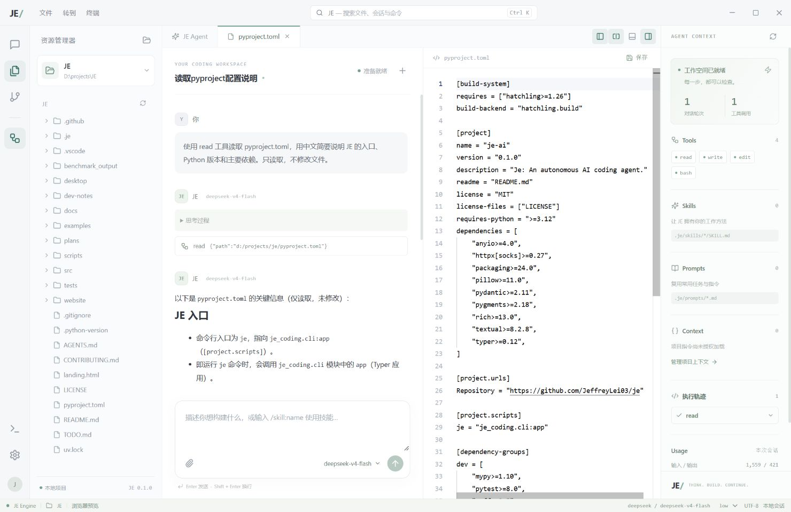

# JE Desktop

面向本地项目的 AI 编码工作台。参考 VS Code 的活动栏、文件树、编辑器标签与底部终端，并采用浅色聊天工作空间。桌面端通过 JSONL RPC 复用 JE 的 `CodingSession`，与终端版共享 `~/.je/` 模型配置、凭据和会话。

## 运行

Windows 便携版：双击 `release/JE Desktop 0.1.0.exe`。已内置 Electron 与 Python 引擎，无需另装 Python。首次进入空白工作目录，点击文件夹按钮选择自己的项目，再连接模型。当前构建未签名。

源码运行需要 Node.js 24+ 与 Python 3.12+：

```powershell
cd D:\projects\JE
uv sync
cd desktop
npm install
npm run dev
```

运行已构建的桌面窗口：`npm run build` 后执行 `npm start`。

## 工作流

- 左侧在会话、文件与 Git 更改间切换。打开项目使用原生目录选择器；会话可以新建和恢复。
- 中间发送任务并查看 Markdown 回答、思考内容和工具调用；停止按钮取消 Agent。
- 点击文件进入本地 Monaco 编辑器，支持多标签和 Ctrl+S。分栏按钮同时展示聊天与代码。保存时若文件已经被外部修改，会提示重新打开，避免覆盖外部更改。
- 右侧始终提供 Tools、Skills、Prompts、Context、执行轨迹与用量。没有资源时显示真实的空状态。
- Skills/Prompts 点击后填入任务；项目内指令需要通过“项目上下文”授权后加载。扩展代码默认关闭。
- 底部终端执行单次命令并显示结果；当前版本不是交互式 PTY，不能运行 vim、交互式 REPL 等长期终端程序。
- 模型按钮筛选/切换已配置模型，状态栏调整思考强度。API key 设置使用 JE 的本机凭据文件，不在前端 localStorage 保存。OAuth 的首次登录继续使用终端版 `/login`。
- Ctrl+K 打开快速入口，Ctrl+` 切换终端，Esc 关闭弹窗或取消当前任务。

## 构建 Windows 便携版

```powershell
cd D:\projects\JE
uv sync
uv pip install pyinstaller
cd desktop
npm ci
npm run package
```

`scripts/build-engine.mjs` 生成 `engine-dist/je-engine.exe`；Electron Builder 将它放入应用 resources。可通过 `JE_PYTHON` 指定构建 Python。开发模式可通过 `JE_REPO` 指定后端仓库。

## 验证

```powershell
npm test
npm run build
npm run smoke
npm run smoke -- "D:\projects\JE\desktop\release\JE Desktop 0.1.0.exe"
```

`smoke` 启动隐藏的真实 Electron 窗口，检查隔离 preload、IPC、静态资源和 Python 引擎，然后自动关闭；传入 EXE 路径时检查打包产物及内置引擎。Python 回归：仓库根目录执行 `uv run pytest tests/test_desktop.py tests/test_rpc.py`。

浏览器验收使用同一套 React 界面和真实 JE 后端：分别运行 `node scripts/preview.mjs` 与 `npm run preview`，访问 `http://127.0.0.1:5174/`。QA bridge 只绑定回环地址，限制 Origin 与临时 token，并禁用凭据提交、项目信任与原生目录选择；发布应用不启动这个 HTTP 服务。

详细设计见 `../docs/desktop-design.md`。这是一版可用的桌面工作台，未实现 VS Code 扩展协议、语言服务器、完整调试器与交互式 PTY。

## 界面验收

下图来自同一套桌面 renderer 的浏览器验收，展示真实项目代码与 DeepSeek 的只读工具任务。


